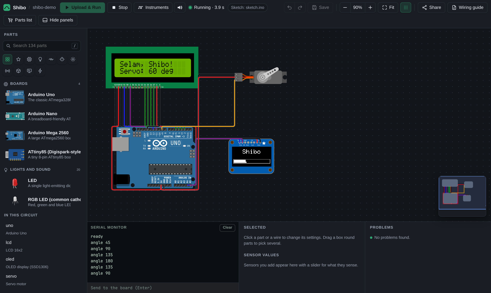

# Shibo

**Shibo** (ሽቦ, Amharic for "wire") is an offline circuit simulator for Arduino sketches. Place parts, wire them, and run your real compiled sketch, before you buy anything. It runs as a VS Code extension and as a local web app, and nothing leaves your computer.



## What it does

- **A catalog of parts** with pictures, grouped and searchable. Drag one onto the canvas, or click it.
- **Easy wiring:** drag from pin to pin, or click one pin and then another. Right-click to remove, Ctrl+Z to undo.
- **Circuit before code:** build the circuit first, then let Shibo write a starter sketch with a named pin for everything you wired.
- **Runs your real sketch:** the same compiled program that would go on the board, on an emulated ATmega328P or ATmega2560. Save the sketch while it runs and it uploads again.
- **Behaves like the bench:** press buttons, turn knobs, set what each sensor senses with a slider. Displays show what your sketch draws.
- **Catches wiring mistakes:** an LED with no resistor, a floating button input, a relay driven straight from a pin, shorted outputs, a sensor with no power.
- **Checks the electrics** with [ngspice](https://ngspice.sourceforge.io/) while it runs: pin current over 20 mA (40 mA absolute), LED current too high or too low for its resistor, 5 V into a 3.3 V part, and how much each supply rail is asked for. Rest the pointer on a wire to read its voltage and current. Without ngspice (set `SHIBO_NGSPICE` to its path, or put it on the PATH) parts show as unchecked.
- **Prints a wiring guide:** what to buy and every connection, with a box to tick as you build.

## Parts

- **Boards:** Arduino Uno, Arduino Nano.
- **Lights and sound:** LED (red, green, blue, yellow, white, orange, pink, purple; 3, 5 and 10 mm), LED with built-in resistor, Infrared LED, Bi-colour LED, RGB LED (common cathode and common anode), Traffic-light module, Laser module (KY-008), LED bar graph, 7-segment display, Buzzer.
- **Boards:** Arduino Uno, Arduino Nano, Arduino Mega 2560 (all 70 pins, A0-A15, Serial to Serial3, external and pin-change interrupts, all six timers), ATtiny85 (Digispark-style, ATTinyCore at 16 MHz: P0-P5, ADC on P2-P5, PWM on P0/P1/P4, software Serial with TX on P0 and RX on P1).
- **Lights and sound:** LED, RGB LED, LED bar graph, 7-segment display, Buzzer.
- **Basics:** Resistor.
- **Switches and knobs:** Push button, Push button (small), Slide switch, Potentiometer, DIP switch (8), Keypad, Joystick, Slide potentiometer, Rotary encoder.
- **Motors and switching:** Relay, Relay module (active low, active high), Servo motor, Stepper motor, Two-hand stepper (clock), Stepper 28BYJ-48 (ULN2003), DC motor, Motor driver (L298N), Motor driver (L9110), Fan (5V), Water pump, Vibration motor, Solenoid.
- **Power:** Battery (9V), Battery pack (4 x AA), LiPo cell (3.7V), Voltage regulator (LM7805, 5V), Voltage regulator (AMS1117, 3.3V), Power switch, Fuse, Breadboard power module.
- **Sensors:** Light sensor (LDR), Temperature sensor (NTC), Gas sensor, Flame sensor, Sound sensor (large), Sound sensor (small), Motion sensor (PIR), Tilt switch, Heartbeat sensor, Ultrasonic distance (HC-SR04), Temperature and humidity (DHT22), Infrared receiver, Load cell amplifier (HX711), Accelerometer and gyro (MPU6050).
- **More sensors:** Temperature sensor (LM35), Temperature sensor (TMP36), UV light sensor (GUVA-S12SD), Rain sensor, Soil moisture sensor, Soil moisture sensor (capacitive), Water level sensor, Air quality sensor (MQ-135), IR obstacle sensor, Line tracker (TCRT5000), Hall sensor, digital (KY-003), Hall sensor, analog (49E), Hall sensor module (KY-024), Reed switch, Tilt ball switch (SW-520D), Force sensor (FSR), Flex sensor, Voltage sensor (0-25 V), Pressure and temperature (BMP280), Pressure, temperature, humidity (BME280), Temperature and humidity (SHT31), Light sensor (BH1750), Accelerometer (ADXL345), Compass (HMC5883L), Compass (QMC5883L), Current sensor (INA219), Pulse oximeter (MAX30102), Temperature sensor (DS18B20), Motion sensor (HC-SR501), Mini motion sensor (AM312), Mini motion sensor (HC-SR505), Vibration sensor (SW-420), Knock sensor (KY-031), Piezo knock sensor, Touch sensor (TTP223), AC voltage sensor (ZMPT101B), Current sensor (ACS712, 5 A), Current sensor (ACS712, 20 A), Current sensor (ACS712, 30 A), Microphone amplifier (MAX4466).
- **Modules:** Infrared remote, Rotary phone dial, Real-time clock (DS1307).
- **Displays:** LCD 16x2, LCD 20x4, OLED display (SSD1306), NeoPixel LED, NeoPixel ring, NeoPixel matrix, NeoPixel strip (WS2812, chainable DOUT to DIN), LED matrix 8x8 (MAX7219, chainable, works with LedControl), 4-digit display (TM1637, works with TM1637Display).
- **Modules:** Infrared remote, Rotary phone dial, Real-time clock (DS1307), Real-time clock (DS3231), EEPROM (24C32), I/O expander (PCF8574), Shift register out (74HC595), Shift register in (74HC165), Analog multiplexer (CD4051), microSD card, Bluetooth (HC-05), GPS (NEO-6M), RFID reader (RC522), Radio (nRF24L01).
- **Displays:** LCD 16x2, LCD 20x4, OLED display (SSD1306), NeoPixel LED, NeoPixel ring, NeoPixel matrix, Colour TFT (ILI9341).

Boards so far: Arduino Uno, Nano, Mega 2560 and ATtiny85. The ATtiny85 needs ATTinyCore (`arduino-cli core install ATTinyCore:avr` with its board-manager URL) and builds as `ATTinyCore:avr:attinyx5micr:sketchclock=16pll`; USB (V-USB/DigiKeyboard) is not simulated. Each compiles for its own board (`arduino:avr:uno`, `arduino:avr:nano`, `arduino:avr:mega`). ESP32 and Raspberry Pi Pico are planned. On the Mega, the serial monitor shows `Serial`; Serial1 to Serial3 run in the sketch but nothing in the catalog talks on them yet.

## Parts list

**Parts list** in the toolbar shows what to buy for the circuit: parts grouped
by what you would ask for in a shop (LED colour and size, resistor value, LCD
with or without an I2C backpack, ...), the board, a breadboard when there are
loose parts, and one jumper wire per wire.

Shibo never makes up a price. Prices come from `prices.json` in the project
folder (currency ETB unless you change it; a shop and a date per entry). The
copy in this repository lists every part with `"price": null`. Type a price or
shop into the panel and it is saved to that file; parts with no price show
"price not set" and the total says how many are missing. If the project folder
cannot be reached, prices are kept in the browser instead. **Export CSV** and
**Export Markdown** write `parts-list.csv` / `parts-list.md` into the project
folder. After adding parts to the engine, run `node scripts/prices.mjs` to
refresh the shipped `prices.json`.

## Install

Shibo is not on the VS Code Marketplace yet. To try it, build the extension package from source:

```
git clone https://github.com/Dagmawi-M/shibo.git
cd shibo
npm install
npm run package
code --install-extension extension/shibo-0.1.1.vsix
```

You also need [arduino-cli](https://arduino.github.io/arduino-cli/latest/installation/) on your PATH with the AVR core:

```
arduino-cli core install arduino:avr
```

Then, in VS Code, click the Shibo icon in the Activity Bar and choose **New Project**.

### Without VS Code

```
npm run app -- path/to/a/sketch/folder
```

and open `http://127.0.0.1:8190`. A Wokwi `diagram.json` in the folder is imported.

## Sharing

**Share → Copy share link** gives a link that holds the whole project: parts,
wires, settings, board and the sketch. Nothing is uploaded anywhere; the
project is compressed into the part of the link after `#p=`, which browsers
never send to a server. Whoever opens the link needs Shibo running (the
standalone app at `http://127.0.0.1:8190/`, or **Share → Open from link…** in
the VS Code panel, where you paste it).

Opening a link replaces the circuit as an edit (Undo brings yours back, and
nothing is saved until you press Save). If your folder already has a
different sketch, it is copied into `.shibo-backup/` before the shared one is
written. A damaged, cut-off, or newer-format link shows a message and changes
nothing.

**Share → Copy embed code** gives an `<iframe>` snippet. The `?embed=1` view
is read-only: the circuit, Run/Stop, the serial monitor and an "Open in Shibo"
link. An embed never replaces unsaved work or a different sketch.

## How it is built

| Folder | What is in it |
|---|---|
| `engine/` | The simulator: one virtual clock, the wiring logic, the part models, the Uno emulator backend (avr8js), and a headless command-line runner |
| `app/` | The editor page. It holds no simulation logic; it sends messages to the engine and draws what comes back |
| `server/` | A small local server that serves the page for use without VS Code |
| `extension/` | The VS Code extension that shows the same page in a panel |

The engine owns time: no chip or part advances except when the engine grants it a slice of virtual time. That is what makes runs repeatable.

## Develop

```
npm install
npm test          # needs arduino-cli; some tests compile real sketches
npm run build     # the page and the extension
```

Tests run with Node's built-in runner, and Node 23 or newer is needed because the TypeScript runs directly.

## Limits today

- Its checks are wiring rules, not a full voltage and current calculation.
- Wires take a simple path and cannot be bent by hand.
- The LCD model ignores custom characters and scrolling.
- The MAX7219 shows its digit registers as matrix rows; its BCD decode mode for 7-segment digits is not drawn. An IR LED does not reach the infrared receiver.

## Credits and licence

Shibo is MIT licensed. It builds on [avr8js](https://github.com/wokwi/avr8js) and [@wokwi/elements](https://github.com/wokwi/wokwi-elements) by Uri Shaked, both MIT. Shibo is an independent project and is not affiliated with Arduino or Wokwi. It contains no Wokwi proprietary code.
