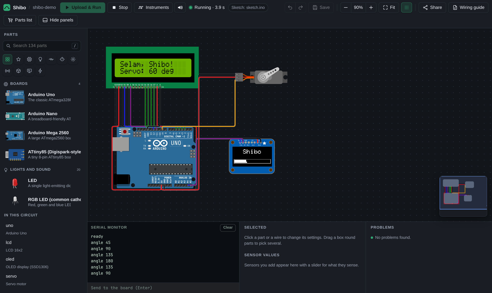

# Shibo

**Shibo** (ሽቦ, Amharic for "wire") is a circuit simulator inside VS Code. Place parts, wire them, and run your real Arduino sketch, before you buy anything. It works offline: your sketches and circuits never leave your computer.

## Start in two minutes

1. Click the **Shibo** icon in the Activity Bar (the left edge of VS Code).
2. Click **New Project**, give it a name, and pick a starting circuit: Blink, Button and LED, Night light, or Empty.
3. The simulator opens beside your sketch. Press **Run**.

Already have a sketch? Open its folder and press the **Shibo** button in the status bar, or the board icon at the top right of any `.ino` file. A Wokwi `diagram.json` in the folder is imported.

## What you can do

- **Pick from a catalog:** every part is shown with its picture, grouped and searchable. Drag one onto the canvas, or click it.
- **Build the circuit before any code:** start in an empty folder, wire things up, then press **Create sketch from circuit** to get a starter sketch with a named pin for everything you connected.
- **Wire the easy way:** drag from one pin to another, or click one pin and then the other. The pin under the pointer is named, and the pins you can finish on light up.
- **Change your mind:** right-click a wire or a part to remove it, or select it and press Delete. Undo and redo with Ctrl+Z and Ctrl+Shift+Z.
- **Manage what is in the circuit:** a list of your components sits under the catalog; select or remove any of them there.
- **Upload and run your real sketch:** **Upload & Run** compiles the sketch in the folder and runs it on an emulated copy of the chip on your board. Save the sketch while it is running and it uploads again by itself.
- **Use it like the real thing:** press buttons, turn knobs, flip switches, type into the serial monitor.
- **Set what sensors sense:** each sensor has a slider for light, temperature, gas, sound and so on.
- **See dimming:** LEDs driven with `analogWrite` are drawn at their brightness.
- **Catch mistakes before they cost you:** an LED with no resistor, a button left floating without a pull-up, a relay coil driven straight from a pin, wires to pins that do not exist, two outputs shorted together, a sensor left without power.
- **Check the electrics:** with ngspice installed, Shibo also checks pin currents, LED currents and voltage levels while the sketch runs.
- **Know what to buy:** **Parts list** shows everything the circuit needs, with your own prices, and exports it as CSV or Markdown.
- **Share a circuit:** **Share** copies a link that holds the whole project. Nothing is uploaded anywhere.
- **Start from a template:** an empty canvas offers Blink, Button and LED, Night light, or Empty.
- **Change any part's settings:** click a part to rename it, pick an LED's colour, choose how an LCD is wired, or rotate it (R). Click a wire to recolour it.
- **Move around:** drag the background to pan, **Fit** to see everything, arrow keys to nudge a part.
- **Print a wiring guide:** a page listing what to buy and every connection, with a box to tick as you build.
- **Zoom** in and out for small parts or big circuits.
- **Keep your files yours:** the circuit is saved as `shibo.json` beside the sketch.

## Parts

More than 130 parts, each with its picture. See them all in the [parts gallery](https://github.com/Dagmawi-M/shibo/tree/main/gallery).

- **Boards:** Arduino Uno, Nano and Mega 2560, and the ATtiny85 (Digispark-style).
- **Lights and sound:** LEDs in eight colours and three sizes, LED with built-in resistor, infrared LED, bi-colour LED, RGB LED (common cathode and common anode), traffic-light module, laser module, LED bar graph, 7-segment display, buzzer.
- **Basics:** Resistor.
- **Switches and knobs:** Push buttons, slide switch, potentiometer, slide potentiometer, DIP switch, keypad, joystick, rotary encoder.
- **Motors and switching:** Relay and relay modules, servo motor, stepper motors (including the 28BYJ-48 with ULN2003), DC motor, motor drivers (L298N, L9110), fan, water pump, vibration motor, solenoid.
- **Power:** 9 V battery, 4 x AA pack, LiPo cell, voltage regulators (LM7805, AMS1117), power switch, fuse, breadboard power module.
- **Sensors (more than 50):** light (LDR, BH1750), temperature (NTC, LM35, TMP36, DS18B20), temperature and humidity (DHT22, SHT31, BME280), pressure (BMP280), gas and air quality (MQ-135), flame, sound, motion (PIR, HC-SR501, AM312, HC-SR505), ultrasonic distance (HC-SR04), tilt, knock and vibration, touch (TTP223), Hall and reed, force and flex, soil moisture, rain, water level, UV, IR obstacle and line tracker, heartbeat and pulse oximeter (MAX30102), accelerometer and gyro (MPU6050, ADXL345), compass (HMC5883L, QMC5883L), current and voltage (INA219, ACS712, ZMPT101B), load cell amplifier (HX711), microphone amplifier (MAX4466), infrared receiver.
- **Modules:** Infrared remote, rotary phone dial, real-time clocks (DS1307, DS3231), EEPROM (24C32), I/O expander (PCF8574), shift registers (74HC595, 74HC165), analog multiplexer (CD4051), microSD card, Bluetooth (HC-05), GPS (NEO-6M), RFID reader (RC522), radio (nRF24L01).
- **Displays:** LCD 16x2 and 20x4, OLED (SSD1306), NeoPixel LED, ring, matrix and strip, LED matrix 8x8 (MAX7219), 4-digit display (TM1637), colour TFT (ILI9341).

Displays show what your sketch draws: text on the LCDs, pixels on the OLED, colours on NeoPixels. Sensors that work by timing (ultrasonic, DHT22, infrared) answer with the same pulses the real ones send, so the usual libraries and `pulseIn` work.

## Needs

- [arduino-cli](https://arduino.github.io/arduino-cli/latest/installation/) on your PATH, with the AVR core: `arduino-cli core install arduino:avr`.
- Optional: [ngspice](https://ngspice.sourceforge.io/) on your PATH (or set `SHIBO_NGSPICE` to its path) for the voltage and current checks.

## Commands

| Command | What it does |
|---|---|
| Shibo: New Project | Creates a folder with a sketch and a wired circuit |
| Shibo: Open Simulator | Opens the simulator for the current folder |
| Shibo: How to Install arduino-cli | Opens the install guide |

## Limits in this version

- Boards are AVR only for now: Uno, Nano, Mega 2560 and ATtiny85 (which needs ATTinyCore). ESP32 and Raspberry Pi Pico are planned.
- Voltage and current checks need ngspice installed. Without it, Shibo checks the wiring rules only.
- It was built and tested on Linux. Reports from Windows and macOS are welcome.

Shibo is an independent project. It is not affiliated with Arduino or Wokwi. Part drawings come from the open-source `@wokwi/elements` library (MIT).

## How it was made

Shibo was designed, directed and tested by me, with the code written using [Claude Code](https://claude.com/claude-code) (Anthropic) as an AI coding assistant.
