# Parts gallery

Every board and part in Shibo's catalog, drawn as the editor draws it: 134 in all.

[Boards](#boards) (4) · [Lights and sound](#lights-and-sound) (20) · [Basics](#basics) (1) · [Switches and knobs](#switches-and-knobs) (9) · [Motors and switching](#motors-and-switching) (14) · [Power](#power) (8) · [Sensors](#sensors) (54) · [Modules](#modules) (14) · [Displays](#displays) (10)

## Boards

<table>
<tr>
<td align="center" valign="top" width="20%">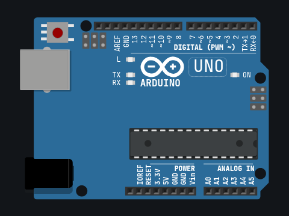 Arduino Uno</td>
<td align="center" valign="top" width="20%">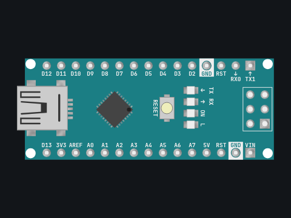 Arduino Nano</td>
<td align="center" valign="top" width="20%">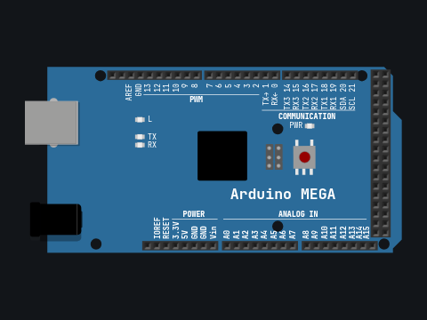 Arduino Mega 2560</td>
<td align="center" valign="top" width="20%">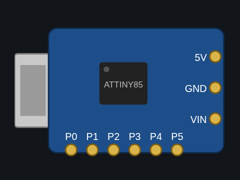 ATtiny85 (Digispark-style)</td>
</tr>
</table>

## Lights and sound

<table>
<tr>
<td align="center" valign="top" width="20%">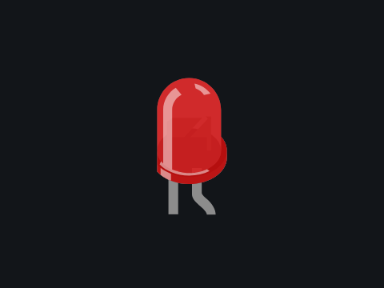 LED</td>
<td align="center" valign="top" width="20%">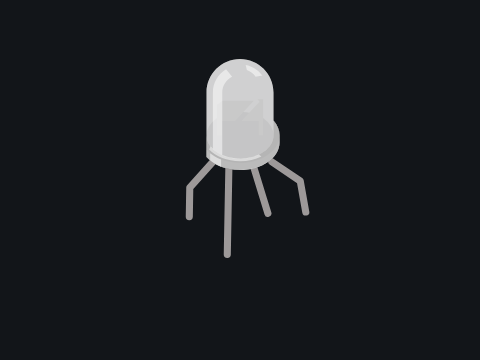 RGB LED (common cathode)</td>
<td align="center" valign="top" width="20%">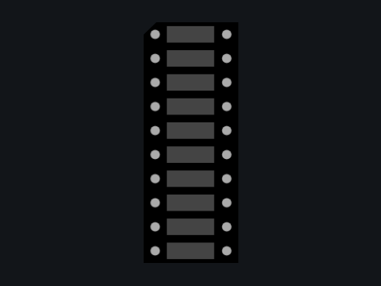 LED bar graph</td>
<td align="center" valign="top" width="20%">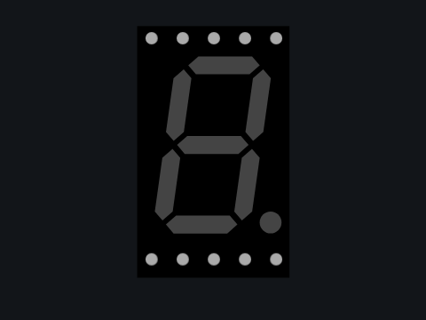 7-segment display</td>
<td align="center" valign="top" width="20%">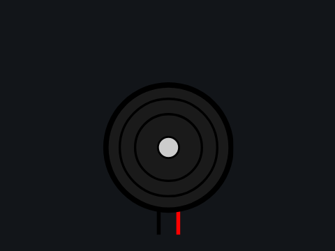 Buzzer</td>
</tr>
<tr>
<td align="center" valign="top" width="20%">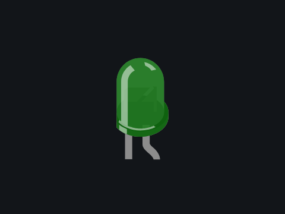 LED (green)</td>
<td align="center" valign="top" width="20%">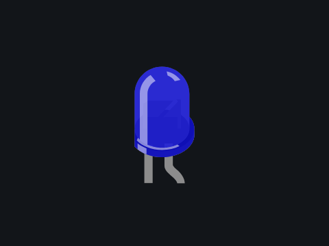 LED (blue)</td>
<td align="center" valign="top" width="20%">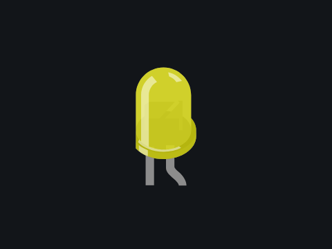 LED (yellow)</td>
<td align="center" valign="top" width="20%">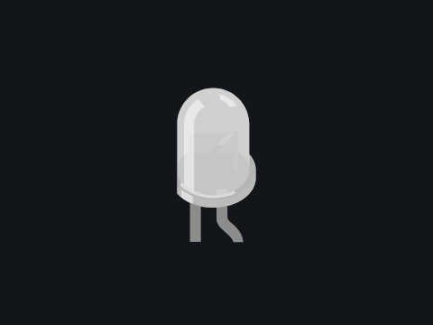 LED (white)</td>
<td align="center" valign="top" width="20%">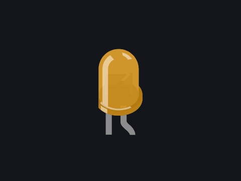 LED (orange)</td>
</tr>
<tr>
<td align="center" valign="top" width="20%">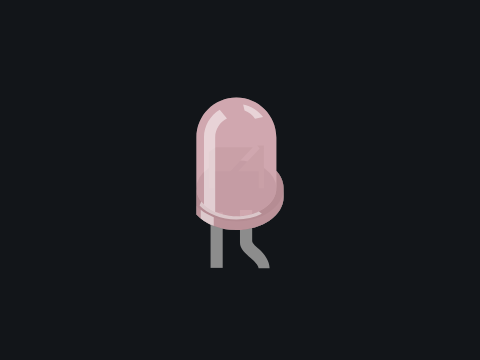 LED (pink)</td>
<td align="center" valign="top" width="20%">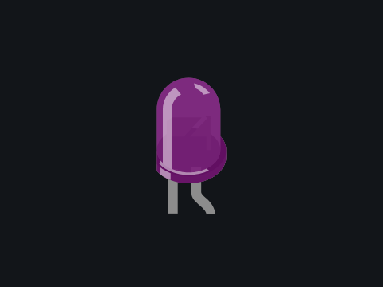 LED (purple)</td>
<td align="center" valign="top" width="20%">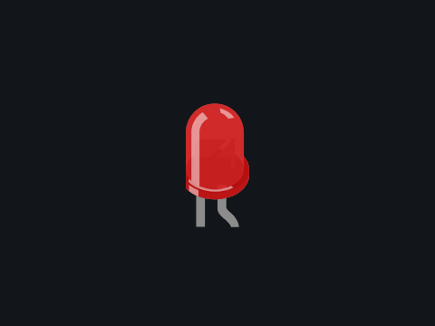 LED 3 mm (red)</td>
<td align="center" valign="top" width="20%">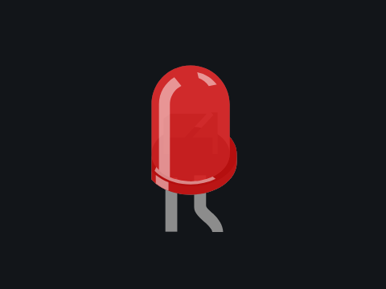 LED 10 mm (red)</td>
<td align="center" valign="top" width="20%">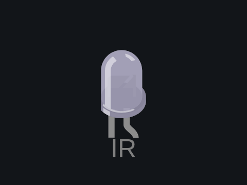 Infrared LED (940 nm)</td>
</tr>
<tr>
<td align="center" valign="top" width="20%">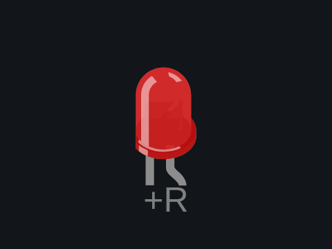 LED with built-in resistor</td>
<td align="center" valign="top" width="20%">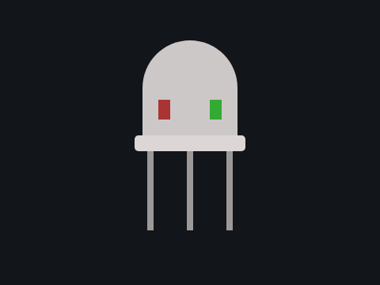 Bi-colour LED (red/green)</td>
<td align="center" valign="top" width="20%"> RGB LED (common anode)</td>
<td align="center" valign="top" width="20%">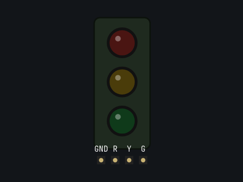 Traffic-light module</td>
<td align="center" valign="top" width="20%">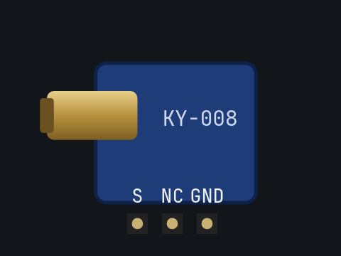 Laser module (KY-008)</td>
</tr>
</table>

## Basics

<table>
<tr>
<td align="center" valign="top" width="20%">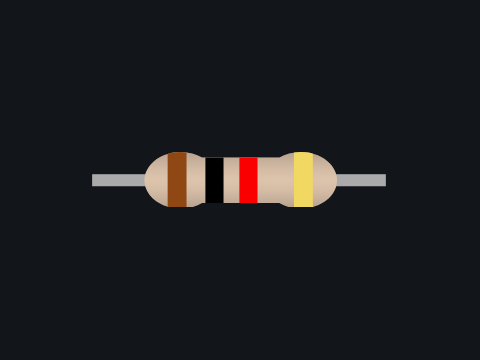 Resistor</td>
</tr>
</table>

## Switches and knobs

<table>
<tr>
<td align="center" valign="top" width="20%">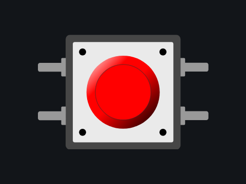 Push button</td>
<td align="center" valign="top" width="20%">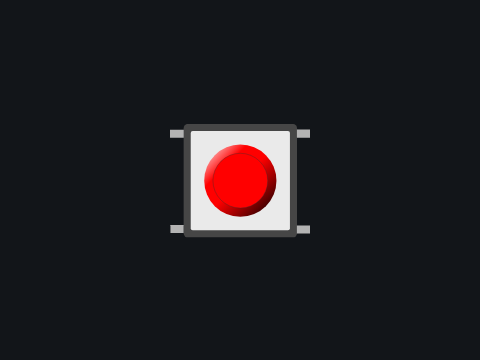 Push button (small)</td>
<td align="center" valign="top" width="20%">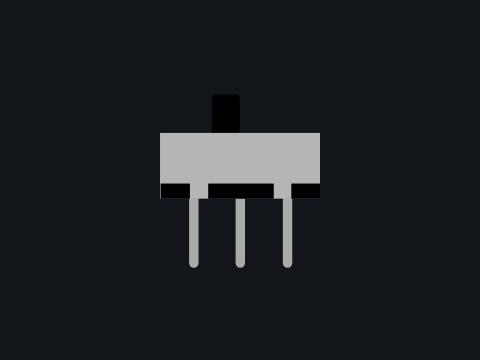 Slide switch</td>
<td align="center" valign="top" width="20%">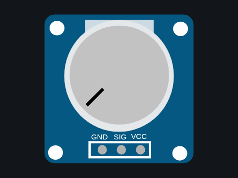 Potentiometer</td>
<td align="center" valign="top" width="20%">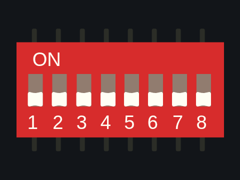 DIP switch (8)</td>
</tr>
<tr>
<td align="center" valign="top" width="20%">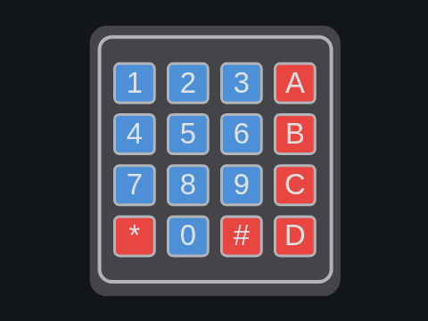 Keypad</td>
<td align="center" valign="top" width="20%">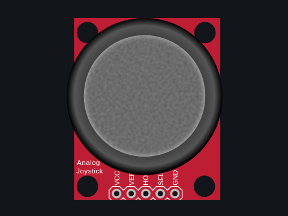 Joystick</td>
<td align="center" valign="top" width="20%">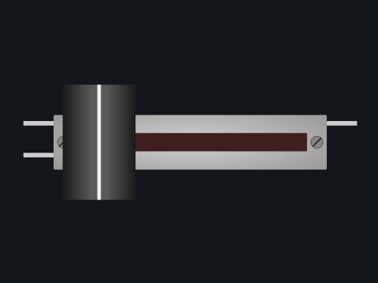 Slide potentiometer</td>
<td align="center" valign="top" width="20%">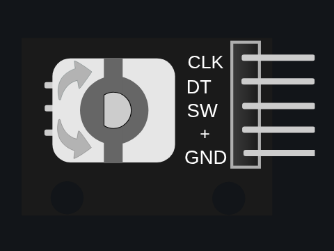 Rotary encoder</td>
</tr>
</table>

## Motors and switching

<table>
<tr>
<td align="center" valign="top" width="20%">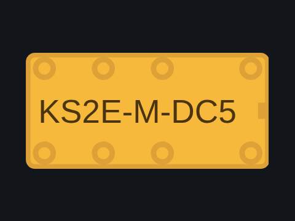 Relay</td>
<td align="center" valign="top" width="20%">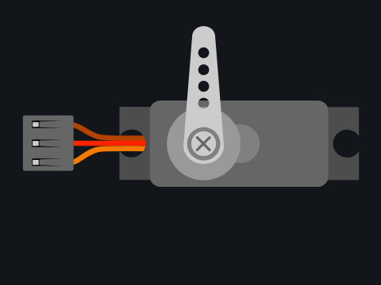 Servo motor</td>
<td align="center" valign="top" width="20%">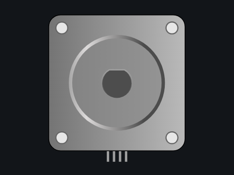 Stepper motor</td>
<td align="center" valign="top" width="20%">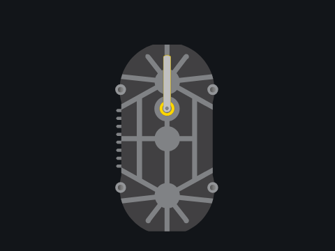 Two-hand stepper (clock)</td>
<td align="center" valign="top" width="20%">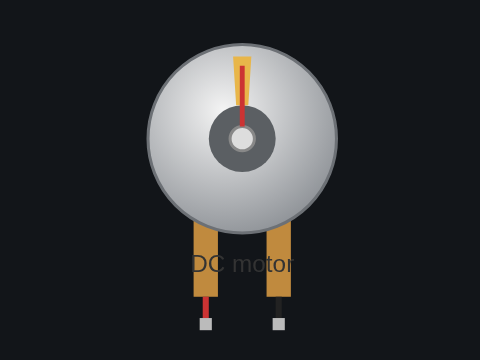 DC motor</td>
</tr>
<tr>
<td align="center" valign="top" width="20%">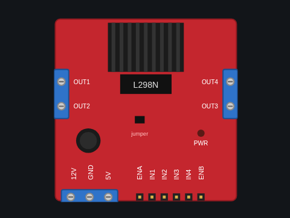 Motor driver (L298N)</td>
<td align="center" valign="top" width="20%">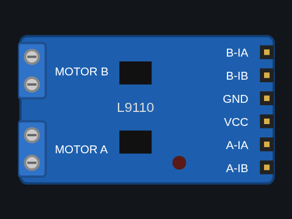 Motor driver (L9110)</td>
<td align="center" valign="top" width="20%"> Relay module (active low)</td>
<td align="center" valign="top" width="20%">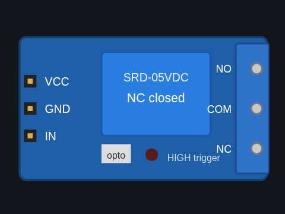 Relay module (active high)</td>
<td align="center" valign="top" width="20%">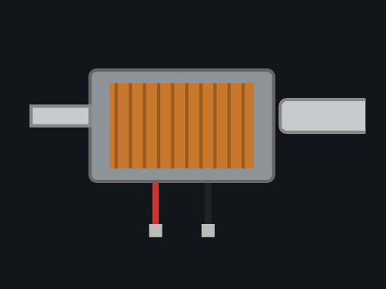 Solenoid</td>
</tr>
<tr>
<td align="center" valign="top" width="20%">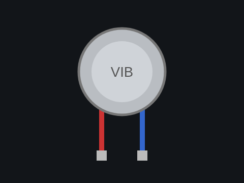 Vibration motor</td>
<td align="center" valign="top" width="20%">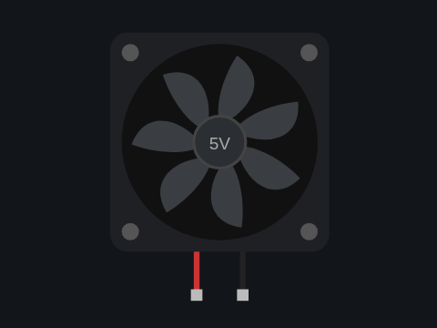 Fan (5V)</td>
<td align="center" valign="top" width="20%">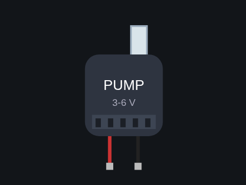 Water pump</td>
<td align="center" valign="top" width="20%">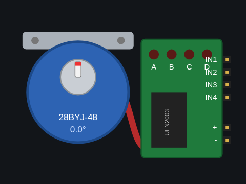 Stepper 28BYJ-48 (ULN2003)</td>
</tr>
</table>

## Power

<table>
<tr>
<td align="center" valign="top" width="20%">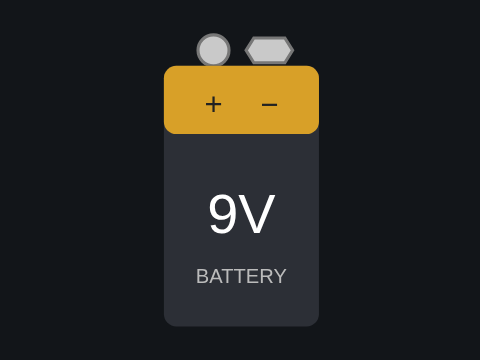 Battery (9V)</td>
<td align="center" valign="top" width="20%">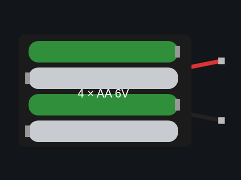 Battery pack (4 x AA)</td>
<td align="center" valign="top" width="20%">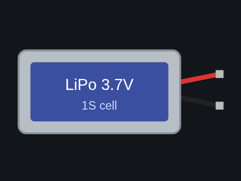 LiPo cell (3.7V)</td>
<td align="center" valign="top" width="20%">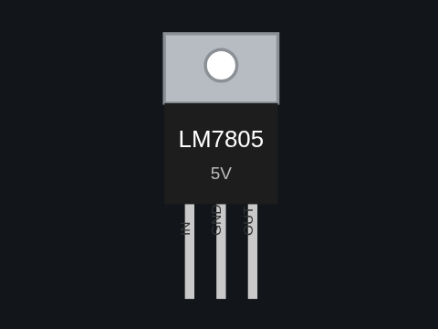 Voltage regulator (LM7805, 5V)</td>
<td align="center" valign="top" width="20%"> Voltage regulator (AMS1117, 3.3V)</td>
</tr>
<tr>
<td align="center" valign="top" width="20%"> Power switch</td>
<td align="center" valign="top" width="20%"> Fuse</td>
<td align="center" valign="top" width="20%"> Breadboard power module</td>
</tr>
</table>

## Sensors

<table>
<tr>
<td align="center" valign="top" width="20%"> Light sensor (LDR)</td>
<td align="center" valign="top" width="20%"> Temperature sensor (NTC)</td>
<td align="center" valign="top" width="20%"> Gas sensor</td>
<td align="center" valign="top" width="20%"> Flame sensor</td>
<td align="center" valign="top" width="20%"> Sound sensor (large)</td>
</tr>
<tr>
<td align="center" valign="top" width="20%"> Sound sensor (small)</td>
<td align="center" valign="top" width="20%"> Motion sensor (PIR)</td>
<td align="center" valign="top" width="20%"> Tilt switch</td>
<td align="center" valign="top" width="20%"> Heartbeat sensor</td>
<td align="center" valign="top" width="20%"> Ultrasonic distance (HC-SR04)</td>
</tr>
<tr>
<td align="center" valign="top" width="20%"> Temperature and humidity (DHT22)</td>
<td align="center" valign="top" width="20%"> Infrared receiver</td>
<td align="center" valign="top" width="20%"> Load cell amplifier (HX711)</td>
<td align="center" valign="top" width="20%"> Accelerometer and gyro (MPU6050)</td>
<td align="center" valign="top" width="20%"> Temperature sensor (LM35)</td>
</tr>
<tr>
<td align="center" valign="top" width="20%"> Temperature sensor (TMP36)</td>
<td align="center" valign="top" width="20%"> UV light sensor (GUVA-S12SD)</td>
<td align="center" valign="top" width="20%"> Rain sensor</td>
<td align="center" valign="top" width="20%"> Soil moisture sensor</td>
<td align="center" valign="top" width="20%"> Soil moisture sensor (capacitive)</td>
</tr>
<tr>
<td align="center" valign="top" width="20%"> Water level sensor</td>
<td align="center" valign="top" width="20%"> Air quality sensor (MQ-135)</td>
<td align="center" valign="top" width="20%"> IR obstacle sensor</td>
<td align="center" valign="top" width="20%"> Line tracker (TCRT5000)</td>
<td align="center" valign="top" width="20%"> Hall sensor, digital (KY-003)</td>
</tr>
<tr>
<td align="center" valign="top" width="20%"> Hall sensor, analog (49E)</td>
<td align="center" valign="top" width="20%"> Hall sensor module (KY-024)</td>
<td align="center" valign="top" width="20%"> Reed switch</td>
<td align="center" valign="top" width="20%"> Tilt ball switch (SW-520D)</td>
<td align="center" valign="top" width="20%"> Force sensor (FSR)</td>
</tr>
<tr>
<td align="center" valign="top" width="20%"> Flex sensor</td>
<td align="center" valign="top" width="20%"> Voltage sensor (0-25 V)</td>
<td align="center" valign="top" width="20%"> Pressure and temperature (BMP280)</td>
<td align="center" valign="top" width="20%"> Pressure, temperature, humidity (BME280)</td>
<td align="center" valign="top" width="20%"> Temperature and humidity (SHT31)</td>
</tr>
<tr>
<td align="center" valign="top" width="20%"> Light sensor (BH1750)</td>
<td align="center" valign="top" width="20%"> Accelerometer (ADXL345)</td>
<td align="center" valign="top" width="20%"> Compass (HMC5883L)</td>
<td align="center" valign="top" width="20%"> Compass (QMC5883L)</td>
<td align="center" valign="top" width="20%"> Current sensor (INA219)</td>
</tr>
<tr>
<td align="center" valign="top" width="20%"> Pulse oximeter (MAX30102)</td>
<td align="center" valign="top" width="20%"> Temperature sensor (DS18B20)</td>
<td align="center" valign="top" width="20%"> Motion sensor (HC-SR501)</td>
<td align="center" valign="top" width="20%"> Mini motion sensor (AM312)</td>
<td align="center" valign="top" width="20%"> Mini motion sensor (HC-SR505)</td>
</tr>
<tr>
<td align="center" valign="top" width="20%"> Vibration sensor (SW-420)</td>
<td align="center" valign="top" width="20%"> Knock sensor (KY-031)</td>
<td align="center" valign="top" width="20%"> Piezo knock sensor</td>
<td align="center" valign="top" width="20%"> Touch sensor (TTP223)</td>
<td align="center" valign="top" width="20%"> AC voltage sensor (ZMPT101B)</td>
</tr>
<tr>
<td align="center" valign="top" width="20%"> Current sensor (ACS712, 5 A)</td>
<td align="center" valign="top" width="20%"> Current sensor (ACS712, 20 A)</td>
<td align="center" valign="top" width="20%"> Current sensor (ACS712, 30 A)</td>
<td align="center" valign="top" width="20%"> Microphone amplifier (MAX4466)</td>
</tr>
</table>

## Modules

<table>
<tr>
<td align="center" valign="top" width="20%"> Infrared remote</td>
<td align="center" valign="top" width="20%"> Rotary phone dial</td>
<td align="center" valign="top" width="20%"> Real-time clock (DS1307)</td>
<td align="center" valign="top" width="20%"> Shift register out (74HC595)</td>
<td align="center" valign="top" width="20%"> Shift register in (74HC165)</td>
</tr>
<tr>
<td align="center" valign="top" width="20%"> Analog multiplexer (CD4051)</td>
<td align="center" valign="top" width="20%"> EEPROM (24C32)</td>
<td align="center" valign="top" width="20%"> Real-time clock (DS3231)</td>
<td align="center" valign="top" width="20%"> I/O expander (PCF8574)</td>
<td align="center" valign="top" width="20%"> microSD card</td>
</tr>
<tr>
<td align="center" valign="top" width="20%"> Bluetooth (HC-05)</td>
<td align="center" valign="top" width="20%"> GPS (NEO-6M)</td>
<td align="center" valign="top" width="20%"> RFID reader (RC522)</td>
<td align="center" valign="top" width="20%"> Radio (nRF24L01)</td>
</tr>
</table>

## Displays

<table>
<tr>
<td align="center" valign="top" width="20%"> LCD 16x2</td>
<td align="center" valign="top" width="20%"> LCD 20x4</td>
<td align="center" valign="top" width="20%"> OLED display (SSD1306)</td>
<td align="center" valign="top" width="20%"> NeoPixel LED</td>
<td align="center" valign="top" width="20%"> NeoPixel ring</td>
</tr>
<tr>
<td align="center" valign="top" width="20%"> NeoPixel matrix</td>
<td align="center" valign="top" width="20%"> NeoPixel strip (WS2812)</td>
<td align="center" valign="top" width="20%"> LED matrix 8x8 (MAX7219)</td>
<td align="center" valign="top" width="20%"> 4-digit display (TM1637)</td>
<td align="center" valign="top" width="20%"> Colour TFT (ILI9341)</td>
</tr>
</table>

The pictures are made by `node scripts/gallery.ts`, which opens each part in the editor and photographs it. Run it again after adding parts.
